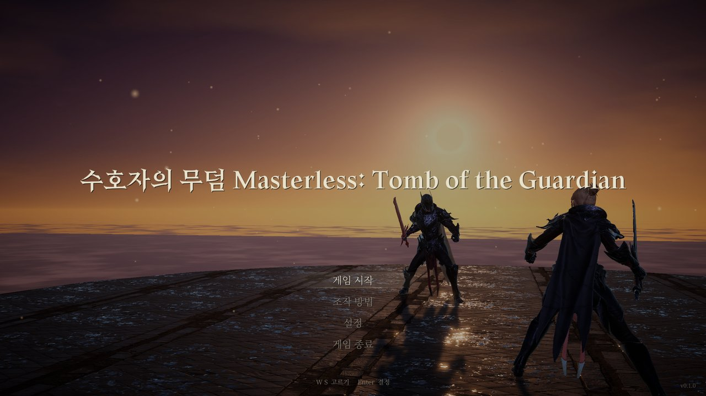
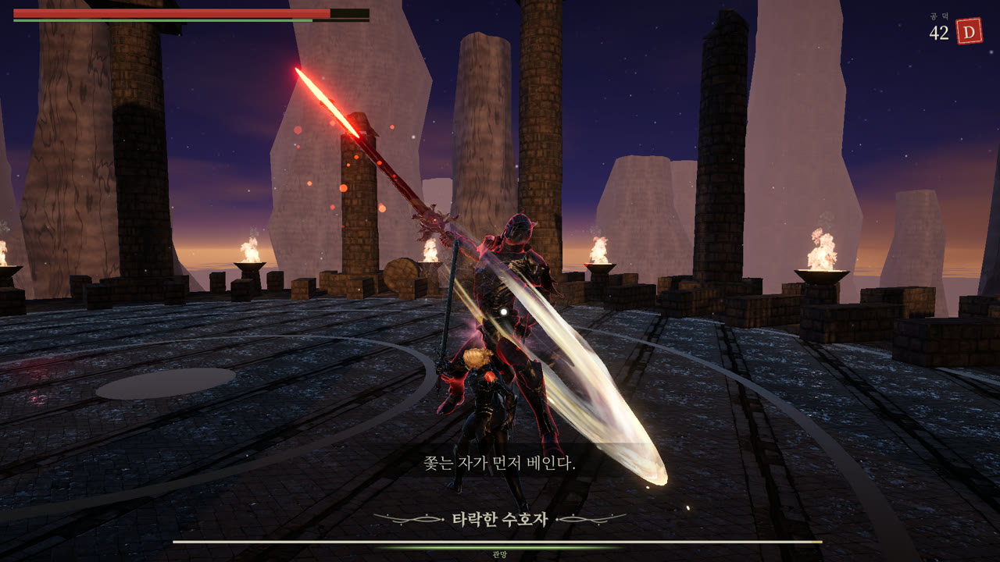
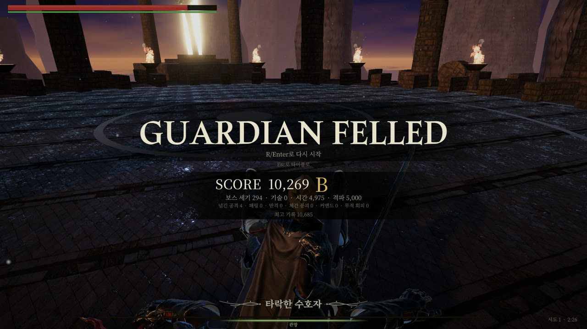

# 수호자의 무덤 · Masterless: Tomb of the Guardian

> Unity 6 (URP) 3인칭 소울라이크 보스전 · Windows · DualSense / 키보드
> 아주대학교 미디어 프로젝트 · 3인 팀 · 2026.08 – 현재

**[▶ 플레이 트레일러 보기](https://drive.google.com/file/d/13aL4C5A8cJc4hHiqXbdEsOoQpcKvt0mG/view)**

| 페이즈 전환 전조 | 마무리 일격 | 결과·점수 |
|---|---|---|
|  |  |  |

## 한 줄 소개

기억을 잃은 제자가 타락한 수호자와 싸우고, 이긴 뒤에야 그가 옛 스승이었음을 알게 되는 1:1 보스전입니다.
난이도 메뉴는 없습니다. 플레이 기록을 읽는 보스 디렉터와 재도전 보정이 전투의 강약을 조절합니다.

## 주요 기능

| 영역 | 내용 |
|---|---|
| 플레이어 전투 | 약·강 콤보와 커맨드 공격(돌진 찌르기·후퇴 베기·차지 강공·킥 등), 구르기·스태미나, 락온, 패링 → 약점 조준 반격 |
| 보스 | 2페이즈 20개 패턴. 체력 50%에서 각성 연출, 20% 이하에서 연속기 '마지막 가르침' |
| 동적 밸런싱 | 판 안에서는 강화학습(PPO) 보스 디렉터가 다음 패턴과 공격 간격을 고르고, 판 사이에는 머신러닝(로지스틱 회귀) 재도전 보정 '스승의 배려'가 보스 체력·피해를 조절 |
| 패배 피드백 | 그 판에서 문제가 된 행동을 짚는 '기억의 파편' (규칙 기반 분석) |
| 점수·등급 | 상대한 보스의 압박과 받은 보정을 반영한 점수, 등급, 최고 기록 |
| DualSense | 공격별 진동 프로파일. Windows 블루투스 연결에서도 진동이 나오도록 HID 출력 직접 처리 |
| 연출 | 셰이더 VFX, 히트스톱·카메라 킥, 실제 칼 궤적에 맞춘 검기, 보스 대사 더빙·자막, 음악, 스토리 컷씬 3편 |
| UI | 타이틀·조작 안내·설정·일시정지·결과 화면, Canvas 전투 HUD |

## 내 역할 (송재혁 · 팀장)

- 일정·우선순위·통합, PR 기반 협업 운영
- 플레이어 전투, 애니메이션·VFX·타격감
- 동적 밸런싱의 데이터 수집·학습·평가와 게임 적용, 점수·텔레메트리
- 후반에는 보스 코드·사운드·연출·안정화까지 담당

팀원: 천지민(보스 AI·패턴·전환·판정, 전투 검증), 이다윤(기획·서사·보스 패턴 기획·UI 와이어프레임·맵과 아트 방향)

## 주안점과 차별점

**1. 난이도 선택 대신, 맞춰 가는 보스**
입문자는 패턴을 볼 기회를, 숙련자는 긴장감을 잃지 않게 하려고 난이도 메뉴를 없앴습니다. 보스 디렉터는 정해진 후보 안에서만 패턴을 고르고, 상하한 안에서만 템포를 조절합니다. 재도전 보정은 3연패부터 다음 판 승률을 예측해 필요한 만큼만, 한 판에 최대 2단계까지만 보스를 약하게 합니다.

**2. 읽을 수 있는 전투**
전조 빛의 색으로 대응을 나눴습니다(붉은색 = 패링, 호박색 = 회피). 패링에 성공하면 시간이 느려지고, 드러난 약점을 겨눠 반격합니다. 검기는 실제 칼이 지나간 궤적에 맞춰, 보이는 칼과 맞는 자리가 어긋나지 않게 했습니다.

**3. 실패가 다음 시도로 이어지게**
패배 화면에서 기대보다 많이 맞은 패턴이나 문제가 된 습관을 짚어 줍니다. 재도전 보정은 '스승의 배려', 보스 압박 표시는 '스승의 기세'로 이름 붙여 시스템을 서사와 연결했습니다.

## 동적 밸런싱 구조

| 구분 | 판 안: 보스 디렉터 | 판 사이: 스승의 배려 |
|---|---|---|
| 방법 | 강화학습 PPO (Unity ML-Agents) | 지도학습 로지스틱 회귀 |
| 입력 | 현재 전투와 지난 도전 기록 관측 62개 | 지난 기록과 후보 보정 단계를 포함한 특징 9개 |
| 출력 | 패턴 19개 중 하나 × 공격 대기 5단계(0.4~1.8초) | 다음 판 보정 단계 0~9 |
| 게임 적용 | ONNX 추론. 모델이 없거나 오류가 나면 기본 추첨으로 복귀 | 회귀 계수를 C#으로 옮겨 계산 |

- 게임 중에 모델을 계속 학습하지 않습니다. 오프라인에서 학습한 모델이 플레이 기록에 따라 다른 선택을 합니다.
- 규칙 봇 3단계를 상대로 학습하고, 디렉터 없음 / 규칙 디렉터 / PPO 디렉터 조건을 같은 빌드에서 비교했습니다.
- 새로 학습한 모델(v6)이 비교 기준을 넘지 못해 v5를 유지했습니다. 최종 체력 환경의 봇 평가에서는 PPO 디렉터가 고정 보스보다 실력별 격차를 줄이지 못했습니다.
- 사람 플레이 로그를 보고, 보스를 빠르게 깎는 플레이어에게는 지나친 봐주기를 막는 하한 규칙을 더했습니다.

## 개발 기록

- 2026.08 저장소 시작, 9월 팀 기획·개발 체계 정리, 11월 전투·동적 밸런싱·연출 통합
- 병합 PR 85개(팀 전체, 문서·에셋 포함), 11/21 테스트 빌드에서 자동 전투 검증 411건 통과
- 멘토링 이후: 보스 공격 판정을 칼 궤적 스윕으로 변경, 프로파일러로 찾은 HUD 비용 절감, 전투 HUD를 Canvas로 전환
- 플레이 테스트 로그를 보고 보스 체력·템포·등급 기준과 특정 패턴의 판정을 다시 조정

## 조작

| 동작 | 키보드·마우스 | DualSense |
|---|---|---|
| 이동 / 카메라 | WASD / 마우스 | 왼쪽 / 오른쪽 스틱 |
| 약공 / 강공(길게 = 차지) | 왼쪽 클릭 / 오른쪽 클릭 | R1 / R2 |
| 구르기 / 달리기 | Space / Shift | ○ / L3 |
| 패링 / 반격 | Ctrl / E | L1 / △ |
| 킥 / 락온 | V / Q | ✕ / R3 |

## 기술 스택

Unity 6000.3 · URP 17.3 · Input System · Unity ML-Agents(PPO, ONNX 추론) · Python(학습·평가·로지스틱 회귀) · Windows HID · Git LFS

외부 자원: 캐릭터 모델·일부 모션·VFX·효과음은 에셋을 가져와 맞춰 썼고, 컷씬 이미지·영상(Midjourney, Unreal 촬영), 더빙(ElevenLabs), 음악(Suno)은 생성 도구로 만들었습니다.

## 이 저장소에 대해

이 저장소는 소개용입니다. 실제 프로젝트는 유료 서드파티 에셋 라이선스 때문에 비공개 저장소에서 관리하며, 여기에는 직접 작성한 스크립트 일부(2026-11-18 시점)만 담았습니다. 전체 소스는 요청 시 공유할 수 있습니다.

| 폴더 | 내용 |
|---|---|
| `src/ML/` | PPO 보스 디렉터 에이전트, 학습 결투장, 규칙 봇, 게임 추론 연결 |
| `src/Combat/` | 점수, 진동(블루투스 DualSense 포함), 타격감 |
| `src/Player/` | 입력 층, 패링·반격, 스태미나 |
| `src/Telemetry/` | 전투 로그 기록(events.jsonl, attempts.csv) |
| `tools/` | PPO 설정, 학습·평가·분석 스크립트 |
