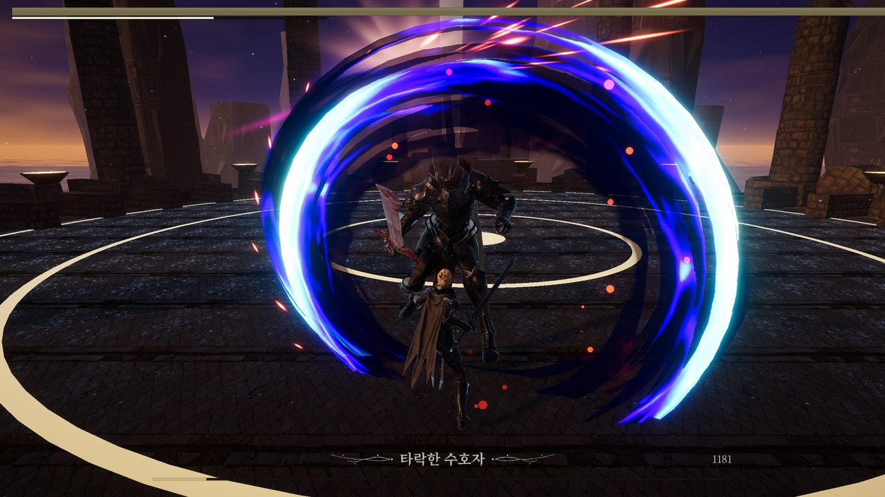

# 수호자의 무덤 · Masterless: Tomb of the Guardian

> Unity 6 (URP) 3인칭 소울라이크 보스전 · DualSense 진동 · 강화학습(PPO) 보스 디렉터
> 아주대학교 미디어 프로젝트 최종 과제 · 3인 팀 · 2026.09 – 2026.11


| 페이즈 전환 전조 | 마무리 일격 | 결과·점수 |
|---|---|---|
|  |  |  |

## 한 줄 소개

기억을 잃은 마지막 제자가 타락한 스승, 수호자와 구름 위 수련장에서 겨루며 싸움법을 되찾는 1:1 보스전입니다.
보스의 패턴 선택과 공격 간격은 **PPO로 학습한 보스 디렉터**가 실시간으로 고르고, 플레이 결과는 점수와 S~D 등급으로 남습니다.

## 핵심 기능

| 영역 | 내용 |
|---|---|
| 전투 | 약·강 3단 콤보와 파생기, 구르기 무적, 스태미나, 패링 → 경직 → 반격(리포스트), 커맨드 공격 6종(돌진 찌르기·후퇴 베기·차지 강공·킥 등) |
| 보스 | 체력 구간 기반 2페이즈. 1페이즈 9패턴, 2페이즈 강화·신규 패턴, 50% 강제 전환 연출, 20% '마지막 가르침' 메인 패턴. 타격 ID 단위 패턴 표 |
| ML | Unity ML-Agents PPO 에이전트가 "다음 패턴 × 공격 대기"를 결정(관측 55, 행동 마스크). 규칙 봇 3단계(초보·중급·숙련)를 상대로 학습하고, ONNX로 게임에 추론 연결. 모델이 없으면 기본 추첨으로 폴백 |
| 점수 | 보스 세기(패턴 가중치 × 압박 배율) + 기술(패링·반격·자세 붕괴·커맨드 적중·회피) + 시간 + 격파. 등급 기준을 봇 평가 분포(숙련 봇 중앙값 = A 하한)로 보정. 패턴 가중치는 전투 로그 로지스틱 회귀로 산출 |
| DualSense | 타격 ID별 진동 프로파일(내려베기 '쿵', 연격 '톡', 찌르기 날카롭게). Unity Input System이 블루투스 DualSense 진동을 못 보내는 문제를 HID 출력 보고서(0x31, CRC32)를 직접 써서 해결 |
| 연출 | 셰이더 VFX(전조 림 라이트·피격 플래시·패링 충격파·2페이즈 각성 불꽃), 히트스톱·카메라 흔들림, 재도전마다 바뀌는 하늘(저녁→새벽→낮), 보스 대사 더빙+자막, 게임 음악, 언리얼 스토리 컷씬 |
| 텔레메트리 | 판마다 `events.jsonl`(타격·회피·패링 이벤트)과 `attempts.csv`(승패·체력·점수) 기록. 설문 없이 플레이 로그로만 평가 |
| UI | 타이틀·조작법(패드/키보드/기술 탭)·일시정지·설정·결과 화면, 락온 점 표시 |

## 강화학습 보스 디렉터 구조

```
 플레이어(사람 / 규칙 봇) ──입력 층 IPlayerCommandSource──▶ 플레이어 컨트롤러
                                                         │
                         관측 55개(거리·체력·페이즈·최근 피격·쿨타임 …)
                                                         ▼
 BossDirectorAgent (PPO) ── 패턴 19개(후보 마스크) × 대기 5단계 ──▶ 보스 FSM
        ▲                                                │
        └──── 보상: 접전 유지 +, 같은 패턴 반복 −, 결말(아슬아슬한 승패 +, 일방적 승패 −) ◀─┘
```

- 학습: 씬 리로드 없이 판마다 리셋하는 학습 결투장, 고정 프레임(1/60초) 시뮬레이션, 여러 환경 병렬 실행
- 평가: 같은 빌드에서 디렉터 없음 / 규칙 디렉터 / 강화학습 디렉터 조건을 봇 단계별로 비교
- 전조·판정·피해 수치는 디렉터가 바꾸지 않습니다. "무엇을, 언제" 낼지만 고릅니다

## 내 역할 (송재혁 · 팀장)

- 기획 방향·일정·통합 관리, PR 기반 협업 운영
- 플레이어 전투 전반(콤보·회피·스태미나·패링·반격·커맨드), 보스 2페이즈와 패턴 확장
- 강화학습 환경·PPO 학습·평가 파이프라인, 점수 시스템, 텔레메트리
- DualSense 진동, VFX·SFX·음악 적용, 애니메이션 연결, 언리얼 컷씬

팀원: 이다윤(기획 문서·보스 패턴 기획표·UI 와이어프레임·맵), 천지민(보스 초기 패턴·판정)

## 조작

| 동작 | 키보드·마우스 | DualSense |
|---|---|---|
| 이동 / 카메라 | WASD / 마우스 | 왼쪽 / 오른쪽 스틱 |
| 약공 / 강공(길게 = 차지) | 왼쪽 클릭 / 오른쪽 클릭 | R1 / R2 |
| 구르기 / 달리기 | Space / Shift | ○ / L3 |
| 패링 / 반격 | Ctrl / E | L1 / △ |
| 킥 / 락온 | V / Q | ✕ / R3 |

## 기술 스택

Unity 6000.3 · URP 17.3 · Input System · AI Navigation · Unity ML-Agents 4.2(PPO, ONNX 추론) · Python(학습·평가·로지스틱 회귀) · Unreal Engine(컷씬) · Git LFS

## 이 저장소에 대해

이 저장소는 소개용입니다. 실제 프로젝트는 유료 서드파티 에셋(캐릭터·애니메이션·환경) 라이선스 때문에 비공개 저장소에서 관리하며, 여기에는 직접 작성한 스크립트 일부만 담았습니다. 전체 소스는 요청 시 공유할 수 있습니다.

| 폴더 | 내용 |
|---|---|
| `src/ML/` | PPO 보스 디렉터 에이전트, 학습 결투장, 규칙 봇, 게임 추론 연결 |
| `src/Combat/` | 점수, 진동(블루투스 DualSense 포함), 타격감 |
| `src/Player/` | 입력 층, 패링·반격, 스태미나 |
| `src/Telemetry/` | 전투 로그 기록(events.jsonl, attempts.csv) |
| `tools/` | PPO 설정, 학습·평가·분석 스크립트 |
